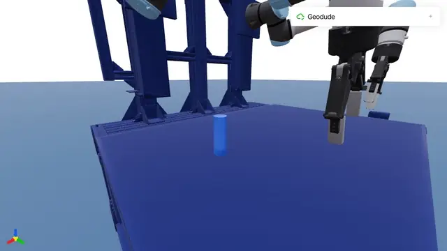
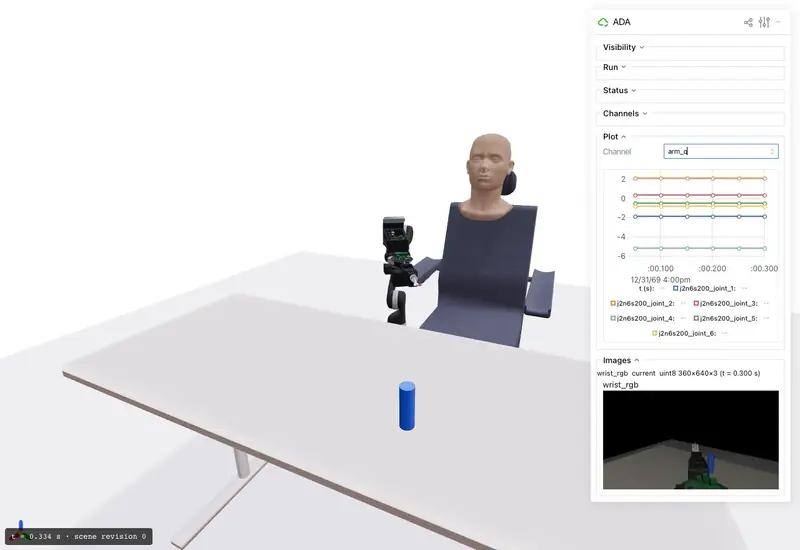
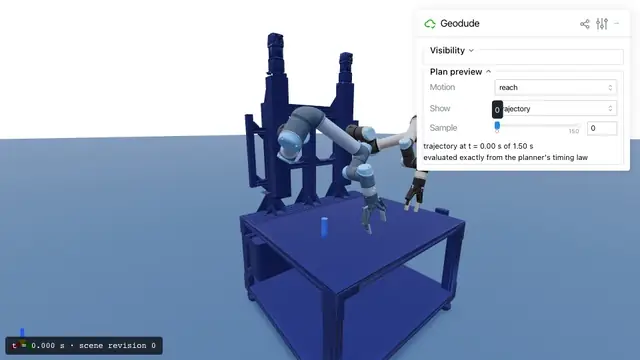
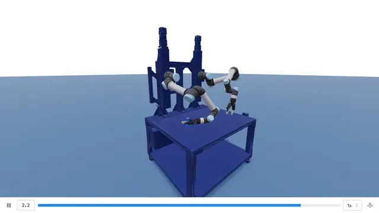
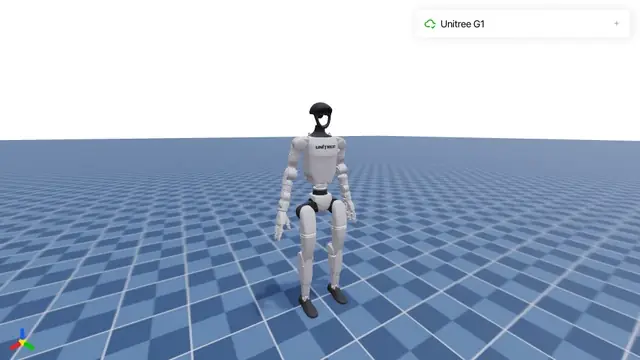
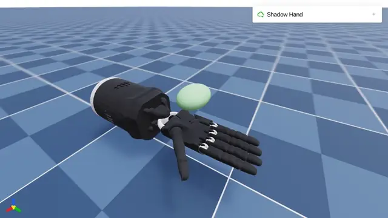

# mj_viser

[](https://github.com/personalrobotics/mj_viser/releases/latest)
[](pyproject.toml)
[](LICENSE)

See any MuJoCo simulation in your browser: live as it runs, as a plan before it runs, or replayed afterwards.

Install with `pip install ssmjviser`; import as `mj_viser`.

mj_viser renders the MuJoCo state you give it, on [Viser](https://github.com/viser-project/viser). It is read-only and caller-driven: it never steps a simulation, commands a robot, or changes your data. Your code owns the model, the clock, and every decision about what runs; teleoperation, task controls, and safety policy belong to your application.

<table>
  <tr>
    <td width="50%">
      <picture>
        <source media="(prefers-reduced-motion: reduce)" srcset="assets/readme/geodude_contacts.jpg">
        
      </picture>
      <br><b>Follow a run live.</b> Geodude grasps a cylinder in an ssrobot run; the contacts appear as it closes its hand.
    </td>
    <td width="50%">
      <picture>
        <source media="(prefers-reduced-motion: reduce)" srcset="assets/readme/ada_live.jpg">
        
      </picture>
      <br><b>Watch its channels.</b> ADA beside its user: joint positions plotted and the wrist camera shown, as the run reads them.
    </td>
  </tr>
  <tr>
    <td width="50%">
      <picture>
        <source media="(prefers-reduced-motion: reduce)" srcset="assets/readme/geodude_preview.jpg">
        
      </picture>
      <br><b>Preview a plan.</b> Scrub a planned reach as a ghost, exactly as the planner timed it, before anything moves.
    </td>
    <td width="50%">
      <picture>
        <source media="(prefers-reduced-motion: reduce)" srcset="assets/readme/geodude_replay.jpg">
        
      </picture>
      <br><b>Replay a run.</b> A saved ssrobot run bundle, converted into a recording for Viser's own player.
    </td>
  </tr>
  <tr>
    <td width="50%">
      <picture>
        <source media="(prefers-reduced-motion: reduce)" srcset="assets/readme/g1.jpg">
        
      </picture>
      <br><b>Any MuJoCo model.</b> Unitree G1, posed by the caller's own loop.
    </td>
    <td width="50%">
      <picture>
        <source media="(prefers-reduced-motion: reduce)" srcset="assets/readme/shadow_hand.jpg">
        
      </picture>
      <br><b>Textured meshes, as MuJoCo draws them.</b> The Shadow Hand through its own keyframes.
    </td>
  </tr>
</table>

Every clip is a real mj_viser session; [scripts/media](scripts/media) records them from public inputs.

## What you can do

- **View your own MuJoCo loop.** Hand the viewer your `MjData` whenever you want it shown; it renders a copy. [Quick start](#quick-start)
- **Follow an ssrobot run live.** Attach to a running [ssrobot](https://github.com/personalrobotics/ssrobot) robot with its named channels, camera images, and contacts, without being able to affect it. [Follow a run](#follow-an-ssrobot-run)
- **Replay a run bundle.** Turn a saved, verified ssrobot run into a recording anyone can scrub. [Replay a run bundle](#replay-a-run-bundle)

Along the way: [plan previews](#preview-a-plan) as per-browser ghosts, [contacts](#contacts) with force arrows, [channel panels](#channels-and-status) with plots and images, and [recordings](#record-states) of any model. Each browser picks what it sees; none can change the run.

## Install

mj_viser needs Python 3.11–3.14. It is published on PyPI as `ssmjviser`, and imported as `mj_viser`:

```bash
pip install ssmjviser
```

Each [release](https://github.com/personalrobotics/mj_viser/releases) also carries its wheel and sdist, with their checksums. It brings MuJoCo, Viser, NumPy, trimesh, and Pillow. The ssrobot integration is optional; for it, install [ssrobot](https://github.com/personalrobotics/ssrobot) with its MuJoCo extra as well:

```bash
pip install "ssrobot[mujoco] @ git+https://github.com/personalrobotics/ssrobot.git"
```

To work on mj_viser itself, see [Development](#development).

## Quick start

<!-- The block below is run as written by the clean-wheel check (scripts/e2e/readme.py). -->

```python
import time

import mujoco

from mj_viser import MujocoViewer  # installed by: pip install ssmjviser

PENDULUM = """
<mujoco>
  <worldbody>
    <light pos="0 0 3"/>
    <geom type="plane" size="1 1 0.1" rgba="0.9 0.9 0.9 1"/>
    <body pos="0 0 1">
      <joint type="hinge" axis="0 1 0"/>
      <geom type="capsule" fromto="0 0 0 0 0 -0.5" size="0.02" rgba="0.2 0.5 0.9 1"/>
      <geom type="sphere" pos="0 0 -0.5" size="0.08" rgba="0.9 0.3 0.2 1"/>
    </body>
  </worldbody>
</mujoco>
"""

model = mujoco.MjModel.from_xml_string(PENDULUM)
data = mujoco.MjData(model)
data.qpos[0] = 1.0  # start it swinging

with MujocoViewer(model, port=0) as viewer:  # any free port on this machine
    print("Open", viewer.url)
    for _ in range(10_000):  # 20 s of simulated time
        mujoco.mj_step(model, data)  # you step; the viewer never does
        viewer.update(data)  # copies data and renders the copy
        time.sleep(model.opt.timestep)
```

Open the printed URL and the pendulum swings. Load your own model with `mujoco.MjModel.from_xml_path("robot.xml")`; [examples/](examples) does the same for any MJCF file, such as a [MuJoCo Menagerie](https://github.com/google-deepmind/mujoco_menagerie) robot.

- `MujocoViewer(model, host="127.0.0.1", port=8080)`: loopback by default; serving other machines is an explicit `host=` choice. `port=0`, as above, picks a free port; `viewer.url` says which.
- `open()` returns the URL and raises `OSError` if the address cannot be bound; `close()` releases it, and `open()` again reuses the viewer. `with` does both.
- `update(data)` recomputes kinematics on its copy, so setting `qpos` alone (for example, replaying a trace) is enough. Panels read that copy as `viewer.data`.

## Follow an ssrobot run

`mj_viser.integrations.ssrobot` connects mj_viser to [ssrobot](https://github.com/personalrobotics/ssrobot) runs. It is the only part of mj_viser that imports ssrobot; importing it without ssrobot says what is needed.

```python
from mj_viser import ContactOverlay, LiveView
from mj_viser.integrations.ssrobot import TraceChannels, render_source

channels = TraceChannels(description)  # an ssrobot trace sink that feeds the channel panels
with RobotContext(description, runtime, sinks=[channels]) as ctx:
    view = LiveView(render_source(ctx), channels=channels.board)
    view.viewer.add_panel(ContactOverlay())
    print(view.open())
    while running:
        ctx.step()  # ssrobot owns time and stepping
        view.refresh()  # captures and renders, at most 30 times a second
    view.close()  # the run keeps going
```

- `render_source(ctx)` adapts ssrobot's read-only render handle. Traces are byte-identical with and without a view attached.
- `TraceChannels` shows the description's channels by joint and component name, each execution's command and states, the scene revision and what is held, and runtime events. Contact channels read as touching and summed normal force.
- A `ContactOverlay` draws the run's contacts from the forwarded state, and agrees with ssrobot's privileged `contact` channels.
- After the runtime reopens, an old view goes stale.

### Preview a plan

```python
from ssrobot.mujoco import materialize_world_from
from mj_viser.integrations.ssrobot import PlanPreview

world = materialize_world_from(package, world=runtime.world(), scene=scene)
preview = PlanPreview(world, description, live=view)
view.viewer.add_panel(preview)
snapshot = ctx.snapshot()
preview.add_result("lift", arm.plan_to_end_effector_offset((0, 0, 1), 0.05, snapshot=snapshot, planner=planner), snapshot)
```

- Each browser picks a result and scrubs its path (the planner's own waypoints) or its trajectory (evaluated exactly from the planner's timing law). Held objects ride their end effectors.
- A result is refused if it was planned in another snapshot, world, or (with `live=`) scene revision, and a shown preview goes stale when the scene changes.
- `add_result(..., validation=)` takes an invalid `MotionValidation` of the plan's own motion and shows its first invalid state, with its location and contacts.
- `record_preview` writes a preview as a recording.

### Replay a run bundle

A run saved as an ssrobot run bundle (`ssrobot.write_bundle`) converts into a native Viser recording. The bundle is verified and its world rebuilt by ssrobot without a runtime, before anything renders:

```bash
python -m mj_viser.integrations.ssrobot.replay run-bundle/ replay/
# replay/recording.viser   the recording
# replay/conversion.json   what is shown when, what is not, and every interval without a frame
```

[Play it](#playing-a-recording) in Viser's player.

- Frames are the run's `SceneSnapshot`s, at the cadence the run took them with `ctx.snapshot()`. Nothing is interpolated.
- Text in the scene shows the run's `TraceChannels` board at each record's time, with camera images beside it. `conversion.json` lists every channel as displayed, malformed, unavailable, or unsupported, and every image reading as shown or malformed.
- A bundle with a missing or changed file is refused, and nothing is written. Moving the bundle does not change the recording.
- `record_trace(records, world)` in the same module converts a trace without a bundle.
- Contact geometry is not in the trace: ssrobot records each contact channel's touching and summed normal force, which the replay shows, but not contact points, normals, or per-contact forces.

## Capabilities

### Live view of any simulation

`LiveView` follows a simulation through a read-only render source (`mj_viser.RenderSource`): an object with its own `model` and `data`, a `world` identity, and `capture()`, which copies the simulation's state into `data` and returns a frame (`time_ns`, `revision`, `world`), or raises `mj_viser.SourceStale` once it can no longer describe the simulation. Any runtime that can expose a MuJoCo model and state can provide one; ssrobot's is above.

```python
from mj_viser import LiveView

view = LiveView(source, max_rate_hz=30)  # source: your RenderSource
print(view.open())  # raises SourceStale if the first frame cannot be shown
while running:
    step_my_simulation()  # your runtime owns time and stepping
    view.refresh()
view.close()
```

- Nothing the viewer does reaches the simulation: the source holds copies.
- `refresh()` never raises because the view was closed or a browser went away, so it cannot stop your loop.
- The HUD shows the simulation's time and scene revision. `expected_world=` refuses a source for any other scene.
- Attach and detach freely with new sources. After a source goes stale, its view renders nothing more.

### Channels and status

Give a `LiveView` a `mj_viser.ChannelBoard` and feed it: `declare` channels (a vector of values with element names, an RGB image, or unsupported), give each a `reading(name, stamp_ns, value)`, set `status` lines, note `event`s, and `advance` its time.

```python
from mj_viser import ChannelBoard

board = ChannelBoard()
board.declare("arm_q", quantity="joint_position", labels=("shoulder", "elbow"))
board.declare("wrist_rgb", kind="image")
view = LiveView(source, channels=board)
board.reading("arm_q", stamp_ns, (0.3, 0.1))
board.set_status("task", "reaching")
```

Each browser gets its own panels:
- each channel's latest reading by element name, with its time, marked `current`, `stale`, `awaiting`, `malformed`, `unavailable` (not provided), or `unsupported`;
- each image channel's latest image, sent at most once per new reading;
- the status lines and recent events;
- a plot of the channel that browser picks.

The panels only show; they hold no control of the run, and one browser's choices never reach another.

### Contacts

`mj_viser.ContactOverlay` draws the contacts of the state the viewer shows, as the simulation computed them (nothing is recomputed): a point, a normal, and a force arrow per contact, from MuJoCo's own contact list and `mj_contactForce`, named by body. Each browser chooses whether contacts show and how long a newton's arrow is; the caption gives the frame's time, the scale, and each contact's force in newtons, and says so when there are none or more than are drawn.

```python
from mj_viser import ContactOverlay

viewer.add_panel(ContactOverlay())  # or view.viewer.add_panel(...) on a LiveView
```

`mj_viser.contact_set(model, data)` returns the same contacts as data, and `StateRecorder(model, contacts=True)` records them with each state, logging every contact and arrow drawn.

### Preview joint motions

`mj_viser.MotionPreview` shows named `JointMotion`s of any model as a translucent ghost of the bodies they move. Each browser picks one and scrubs its waypoints, or its timed motion at exact times, in its own scene. A motion may carry a `Highlight`, such as an invalid state, shown with its caption. Nothing is executed. `mj_viser.preview.record_motion` writes a motion as a recording. ssrobot's `PlanPreview` is built on it.

### Record states

`mj_viser.StateRecorder` writes any model's states, text, and RGB images into a native Viser recording at the times you give:

```python
from mj_viser import StateRecorder

with StateRecorder(model) as recorder:
    for time_ns, data, lines in my_states:
        recorder.advance(time_ns)
        recorder.show(data)
        recorder.text(lines)
    open("run.viser", "wb").write(recorder.finish())
```

Nothing is interpolated: each state shows from its time until the next.

#### Playing a recording

Build Viser's client, serve it with the recording, and open the player:

```bash
viser-build-client --out-dir client/
python -m http.server
# http://localhost:8000/client/?playbackPath=http://localhost:8000/run.viser
```

### Sensor plots

```python
from mj_viser import SensorChannel, SensorPanel

viewer.add_panel(SensorPanel(
    title="Wrist F/T",
    channels=[
        SensorChannel(0, "Fx", "#e74c3c"),
        SensorChannel(1, "Fy", "#2ecc71"),
        SensorChannel(2, "Fz", "#3498db"),
    ],
    window_seconds=5.0,
))
```

### HUD, selection, and custom panels

```python
viewer.set_hud("status", "L: [13N] can_0 | R: — | physics", "bottom-left")  # shown as text; markup is escaped
viewer.on_select(lambda geom_id, body_name: print(f"Selected: {body_name}"))
```

Clicking a geom labels its body for that browser only; the label follows the object. Each browser has its own selection.

```python
import viser

from mj_viser import MujocoViewer, PanelBase

class MyPanel(PanelBase):
    def name(self) -> str:
        return "My Panel"

    def setup(self, gui: viser.GuiApi, viewer: MujocoViewer) -> None:
        with gui.add_folder(self.name()):
            self._text = gui.add_text("Status", initial_value="", disabled=True)

    def on_sync(self, viewer: MujocoViewer) -> None:
        self._text.value = f"Time: {viewer.data.time:.2f}"

viewer.add_panel(MyPanel())
```

### Groups

As in MuJoCo, geom and site groups 0–2 are shown and 3–5 hidden by default. The Visibility panel has a checkbox for each group in use; applications can set the same state directly, for example to show sensor sites kept in group 4:

```python
viewer.set_visible_groups(sites=range(6))  # show every site group
viewer.set_visible_groups(geoms={0, 1, 2, 3})  # also show geom group 3
viewer.visible_groups()  # {"geoms": {0, 1, 2, 3}, "sites": {0, ..., 5}}

viewer = MujocoViewer(model, show_visibility=False)  # no panel; groups still apply
```

Group ids are MuJoCo's 0–5; anything else (a float, a string, a bool, or an id out of range) raises `TypeError` or `ValueError` and leaves the current setting unchanged.

### Scene report

```python
report = viewer.scene_report()  # plain JSON-ready data; works before open()
report["bodies"][1]["path"]  # e.g. "/mujoco/b0_world/b1_trunk"
report["unsupported"]  # e.g. [{"kind": "light", "name": "spotlight", "reason": "MuJoCo lights are not rendered; ..."}, ...]
report["coverage"]["site"]  # e.g. {"total": 9, "rendered": 8, "filtered": 1, "unsupported": 0}
```

`coverage` accounts for every geom, site, light, camera, tendon, skin, and flex in the model: each is rendered, filtered (with the reason in its entry), or listed in `unsupported`. The report depends only on the model, so it is the same wherever the model is rendered.

The scene has one Viser frame per MuJoCo body, with its geoms and sites beneath it. Paths are built from MuJoCo ids plus sanitized names (`b3_trunk`, `g7`, `s2_imu`), so they are stable for a model and unique even for unnamed elements or names that differ only in punctuation.

## How MuJoCo geometry is converted

Each rule follows MuJoCo's own visualizer, and the end-to-end check compares the result with it.

- **Types**: box, sphere, cylinder, capsule, ellipsoid, plane, and mesh render. Height fields and SDFs do not and are listed in `scene_report()["unsupported"]`.
- **Color**: a material's rgba applies only while the geom's rgba is MuJoCo's default `0.5 0.5 0.5 1`; an explicit geom rgba wins.
- **Filtering**: a geom or site whose resolved alpha is 0 is not drawn (`filtered` in the report). Groups 0–2 are visible and 3–5 hidden by default, as in MuJoCo; see [Groups](#groups).
- **Sites**: sphere, capsule, ellipsoid, cylinder, and box sites render with MuJoCo's size, local pose, and color rules (the same material rule as geoms).
- **Textures**: 2D textures render on meshes with texture coordinates and on planes. Meshes and planes honor the material's `texrepeat`, and planes also `texuniform`, as MuJoCo's renderer does. Textures on other geom types, and cube or skybox textures, are not drawn; the geom keeps its base color and the report lists it. STL meshes render double-sided.
- **Infinite planes** (size 0) render as a square of half-size 50 m, noted in `scene_report()["diagnostics"]`.

## Compatibility

[docs/api.md](docs/api.md) lists the public API, which follows Semantic Versioning from 1.0.0, and how versions, deprecations, and releases work.

| | Supported |
| --- | --- |
| Python | 3.11–3.14 (3.15 awaits wheels for Viser's `zstandard` dependency) |
| MuJoCo | `>=3.12` (the texture layout mj_viser reproduces); locked to 3.14.0, the version ssrobot pins |
| Viser | `>=1.1.1,<1.2` |
| NumPy | `>=1.24` |
| trimesh | `>=3.21.7` |
| Pillow | `>=9.2` |

CI runs the same end-to-end check from a clean wheel install, in parallel jobs, on the exact wheel it builds and uploads together with each run's report and recording: the locked versions (`uv.lock`) on every supported Python, every declared minimum on Python 3.11, and the newest allowed releases (on Python 3.14 for pull requests; on every Python for `main` and a nightly run). It runs the [quick start](#quick-start) as written, and renders public robots from MuJoCo Menagerie (`trossen_wxai`, `robotiq_2f85`, `unitree_go1`) at a pinned commit. Separate jobs check the ssrobot integration on its reference robots, Geodude and ADA.

## Development

Development uses [uv](https://docs.astral.sh/uv/):

```bash
git clone https://github.com/personalrobotics/mj_viser.git
cd mj_viser
uv sync --locked --all-extras
uv run ruff check . && uv run ruff format --check .
uv run mypy src
```

The end-to-end check builds the wheel, installs it into a clean virtualenv, and exercises the installed package:

```bash
UV_PYTHON=3.12 scripts/smoke_wheel.sh dist/smoke locked
```

It writes `dist/smoke/locked/smoke_report.json` (results, input-state hashes, installed versions, wheel sha256) and `dist/smoke/locked/two_states.viser`, a recording of two rendered states; [play it](#playing-a-recording) to see them. Add `lowest` and `latest` to run the declared-minimum and newest-release environments too. [CONTRIBUTING.md](CONTRIBUTING.md) has the rest.

## Citation

If mj_viser helps your work, please cite it. [CITATION.cff](CITATION.cff) holds its citation metadata, and GitHub's **Cite this repository** button (in the repository's sidebar) turns it into APA or BibTeX.

## License

[MIT](LICENSE)
